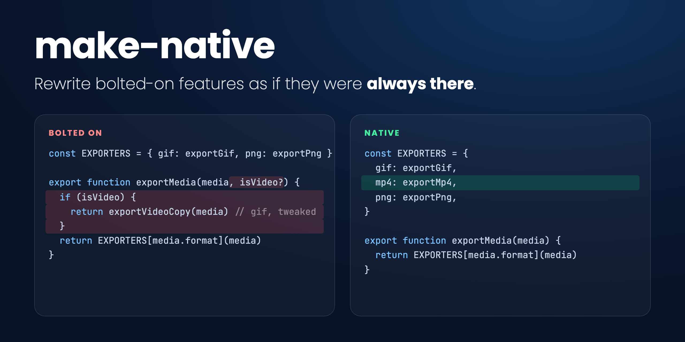

# make-native

An [Agent Skill](https://agentskills.io) that rewrites a bolted-on feature so it reads as if it was always part of the original design.



```sh
npx skills add Sloydai/make-native
```

Works with Claude Code, Codex, opencode, Kiro, and GitHub Copilot. See [Install](#install) for manual setup.

Made by [@Edesberg](https://x.com/Edesberg) at [Sloyd](https://sloyd.ai). If it saves you a refactor, give it a star.

Coding agents (and people in a hurry) tend to add features with the least possible disturbance: an `if (newThing)` here, a flag there, a copy of an existing component for the new variant, and tests that prove nothing else changed. Each change is safe on its own. Together they leave code that only makes sense if you know the order it was written in.

`make-native` takes the feature diff and asks: if the original author had known about this feature on day one, what would the code look like? Then it writes that version, deletes the workarounds, and rewrites the tests to match.

## What it does

1. Reads the feature diff against the PR's base branch and lists everything the feature added.
2. Reads the surrounding code, types, callers, and git history until it understands why the code has its current shape.
3. Redesigns the touched code as if the feature had been in the original spec, and simplifies where it can.
4. Makes the common cases simple first, and handles edge cases without complicating the main path.
5. Rewrites the tests for the new design and removes tests that only preserved the workaround.
6. Checks that no trace of the old workaround remains.

It looks for these smells:

- aliases that re-derive a value the code already has
- `if (newKind)` branches in code that already dispatches on kind
- near-copies of an existing file or component for one variant
- flags or booleans that duplicate what a type already says
- a second system for a concern that already has one (cost tracking, logging, retries, config)

It is meant for features only. Bug fixes should stay minimal, so don't run it on a bug-fix commit.

## Install

The skill is a single file: [`skills/make-native/SKILL.md`](skills/make-native/SKILL.md). Copy the `make-native` folder into your agent's skills directory.

| Agent | Project-level | User-level |
| --- | --- | --- |
| Claude Code | `.claude/skills/make-native/` | `~/.claude/skills/make-native/` |
| Codex | `.agents/skills/make-native/` | `~/.agents/skills/make-native/` |
| opencode | `.opencode/skills/make-native/` | `~/.config/opencode/skills/make-native/` |
| Kiro | `.kiro/skills/make-native/` | `~/.kiro/skills/make-native/` |
| GitHub Copilot | `.github/skills/make-native/` | |

For example, to install it for Claude Code in the current project:

```sh
git clone --depth 1 https://github.com/Sloydai/make-native.git /tmp/make-native
mkdir -p .claude/skills
cp -r /tmp/make-native/skills/make-native .claude/skills/
```

Or with the [`skills` CLI](https://github.com/vercel-labs/skills):

```sh
npx skills add Sloydai/make-native
```

## Usage

After you finish a feature on a branch, ask your agent:

> Use make-native on this branch.

The agent will produce a separate commit (a `refactor` if behavior is unchanged, a `feat` if it is), so you can review the reshape apart from the feature itself.

## License

[MIT](LICENSE)
